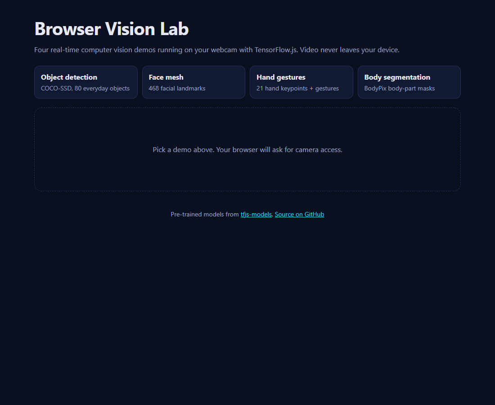

# Browser Vision Lab

Four real-time computer vision demos that run on your webcam, entirely in the browser, with TensorFlow.js and React.

**Live demo: https://smadhu6364-beep.github.io/aiml-project/**


[](https://github.com/smadhu6364-beep/aiml-project/actions/workflows/pages.yml)



## Demos

| Demo | What it does | Model |
|---|---|---|
| Object detection | Boxes and labels 80 everyday object types | COCO-SSD |
| Face mesh | Tracks 468 facial landmarks and draws the mesh | MediaPipe FaceMesh (`face-landmarks-detection`, tfjs runtime) |
| Hand gestures | 21 hand keypoints, plus thumbs-up / victory recognition | MediaPipe Hands (`hand-pose-detection`) + fingerpose |
| Body segmentation | Colours each body part | BodyPix |

The models are pre-trained by Google; this project is about loading them in the browser, running inference on live video and drawing the results. No video is uploaded anywhere.

## Quick start

```bash
git clone https://github.com/smadhu6364-beep/aiml-project.git
cd aiml-project
npm install
npm run dev        # http://localhost:5173
npm run build      # production build in dist/
```

Camera access needs `localhost` or HTTPS. The GitHub Pages site is HTTPS, so it works there.

## Structure

```
src/
  App.jsx            demo picker
  CameraStage.jsx    webcam + canvas loop shared by every demo
  demos/             one file per model (objects, face, hands, body)
docs/report/         original university project report and notes
.github/workflows/   build on every push, deploy master to GitHub Pages
```

## Changes in the 2026 refresh

The project started as four separate Create React App projects. It is now one Vite app:

- Create React App (unmaintained) -> Vite 8, React 18 -> 19
- `@tensorflow-models/facemesh` 0.0.5 (deprecated) -> `face-landmarks-detection` 1.0.6
- `@tensorflow-models/handpose` 0.0.7 (deprecated) -> `hand-pose-detection` 2.0.1, and the fingerpose gesture check is now actually wired in
- TensorFlow.js 4.1 -> 4.22, COCO-SSD 2.2.3
- Models load lazily, so the first page load is small

## Status and limits

- Builds and deploys through GitHub Actions. All four models were checked loading and running against a synthetic camera feed in headless Edge; real-world accuracy was checked by hand only.
- BodyPix is no longer developed by Google (its successor is `body-segmentation`). It is kept because it is the only one that gives the coloured per-part masks this demo shows, and it still works with TensorFlow.js 4.22.
- Runs best on a laptop with a GPU. Phones work but slower.
